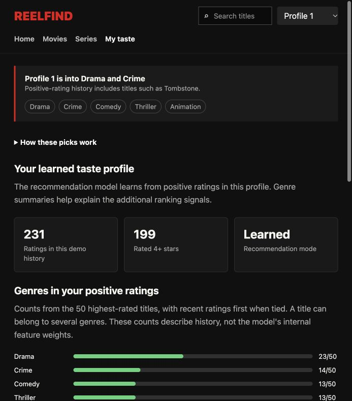
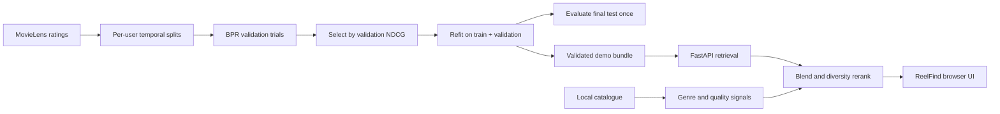

# Netflix AI Recommendation System

A Netflix-inspired movie discovery application with a trained **Bayesian Personalized Ranking (BPR)** model, an explainable recommendation API, and a browser demo called **ReelFind**. Built as a final-year project and educational portfolio demonstration; it is not affiliated with Netflix.

[](https://github.com/s151135/netflix-style-recsys/actions/workflows/ci.yml)



## What works

- Personalized recommendations learned from MovieLens ratings, with seen and blocked titles excluded.
- Different viewer profiles, a new-viewer popularity fallback, and a My taste dashboard with rating history and genre summaries.
- Title search, film/series browsing, title details, and source labels explaining learned picks versus genre discoveries.
- Separate training, validation, and test data; model selection uses validation NDCG only.
- A baseline comparison, reproducible model build, API validation, readiness checks, Prometheus metrics, and Docker deployment.

The AI is **collaborative filtering**: BPR learns numerical representations of users and movies to rank liked titles above alternatives. Genre blending and diversity reranking are explicit heuristics. Explanations are templates, not generated text. Two-tower and SASRec modules are experimental scaffolding, not implemented project features.

## Run locally

Use Python **3.12** for the recorded environment. Python 3.13 is also checked by CI.

```bash
git clone https://github.com/s151135/netflix-style-recsys.git
cd netflix-style-recsys
python3.12 -m venv .venv
source .venv/bin/activate
python -m pip install -r requirements-dev.lock
python -m pip install --no-deps -e .
python scripts/build_demo.py
make demo
```

Open [http://127.0.0.1:8000](http://127.0.0.1:8000). The first build downloads MovieLens and reproduces the selected 16-factor, 5-epoch model. No API key or GPU is needed. Cached data are reused on later builds. Existing model bundles are not overwritten; choose a fresh path with `--output-dir` and point `RECSYS_ARTIFACT_DIR` to it when starting the API.

Try **My taste**, switch between profiles, inspect a recommendation's **Details**, then select **New viewer**. Sample profiles are anonymized MovieLens users, not accounts or real-time viewing sessions. The application does not stream films, collect new ratings, or retrain from clicks.

Title cards work without external images. Optional legacy TMDB artwork references are disabled by default. See [data and media credits](THIRD_PARTY_NOTICES.md) before enabling them.

## Results

The validation-selected model achieved the following held-out results on this dataset snapshot:

| Metric at K=10 | BPR | Popularity |
| --- | ---: | ---: |
| Recall | **0.06199** | 0.05391 |
| MRR | **0.02508** | 0.02175 |
| NDCG | **0.03373** | 0.02944 |
| Catalogue coverage | **1.59%** | 1.48% |

BPR found 23 of 371 positive targets versus 20 for popularity: **15% higher relative Recall@10** in this run, or 0.81 percentage points. This small difference comes from one seed and one split; it is not a statistical significance claim. These metrics measure retrieval, not the final UI's heuristic reranking.

See the [evaluation protocol and earlier baseline](docs/EVALUATION.md), [machine-readable experiment](docs/benchmarks/movielens-validation.json), and [model card](docs/MODEL_CARD.md) for settings and limitations. To rerun selection:

```bash
python scripts/tune_local.py --output-dir artifacts/experiments/my_run
python scripts/prepare_demo.py --experiment-dir artifacts/experiments/my_run --output-dir artifacts/my_demo
RECSYS_ARTIFACT_DIR=artifacts/my_demo python -m uvicorn recsys.serving.api:app --host 127.0.0.1 --port 8000
```

## Architecture



The final-test events stay out of the demo's profile history. The per-user split does **not** impose a global time cutoff across users. MovieLens is historical ratings data, and the small curated series catalogue has no learned collaborative scores.

## Verify and deploy

```bash
python -m unittest discover -s tests -v
ruff check recsys scripts tests
python -m build
```

Tests use small fixtures and do not download MovieLens. CI also builds a wheel, checks the installed UI assets, and builds/smoke-tests the Docker image. The Docker build downloads the dataset and reproduces the recorded model.

```bash
docker compose up --build
```

The container runs as a non-root user and includes its trained model. No Redis, database, or MLflow server is required. For a public host, use the repository's Dockerfile at `infra/docker/Dockerfile`, port 8000, and `/readyz` as the readiness endpoint. See [deployment instructions](docs/DEPLOYMENT.md) for commands, configuration and hosting boundaries.

| Endpoint | Purpose |
| --- | --- |
| `/` | Browser demo |
| `/docs` | Interactive API documentation |
| `/healthz` | Process liveness |
| `/readyz` | Model readiness; 503 when unavailable |
| `/model-info` | Model type, dimensions and selection status |
| `/recommend` | POST recommendations with bounded, validated context |
| `/profile/{user_id}` | Positive-rating history and taste summary |
| `/catalog`, `/title/{item_id}`, `/browse-rows` | Discovery catalogue |
| `/metrics` | Prometheus recommendation counters and latency |

## Project documentation

- [Deployment and smoke testing](docs/DEPLOYMENT.md)
- [Model card and limitations](docs/MODEL_CARD.md)
- [Evaluation details](docs/EVALUATION.md)
- [Demo walkthrough and CV wording](docs/PORTFOLIO.md)
- [Version 1.0.0 changes](CHANGELOG.md)
- [Data and third-party notices](THIRD_PARTY_NOTICES.md)

The maintained release path is BPR training, evaluation, serving, and the demo. Additional ALS, ANN, feature, batch, and monitoring modules are supporting experiments and extension points. This is an educational demo, not a production streaming service or an implementation of Netflix's private recommendation system.
